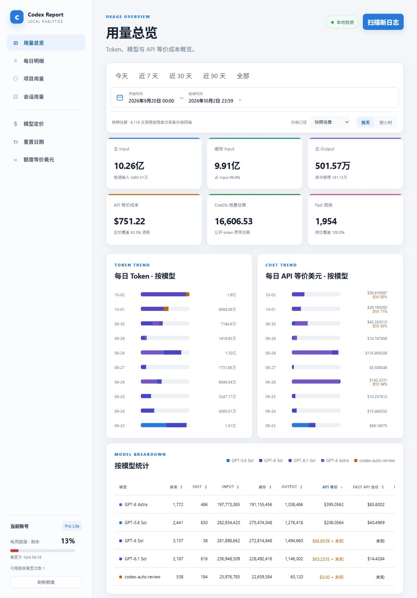
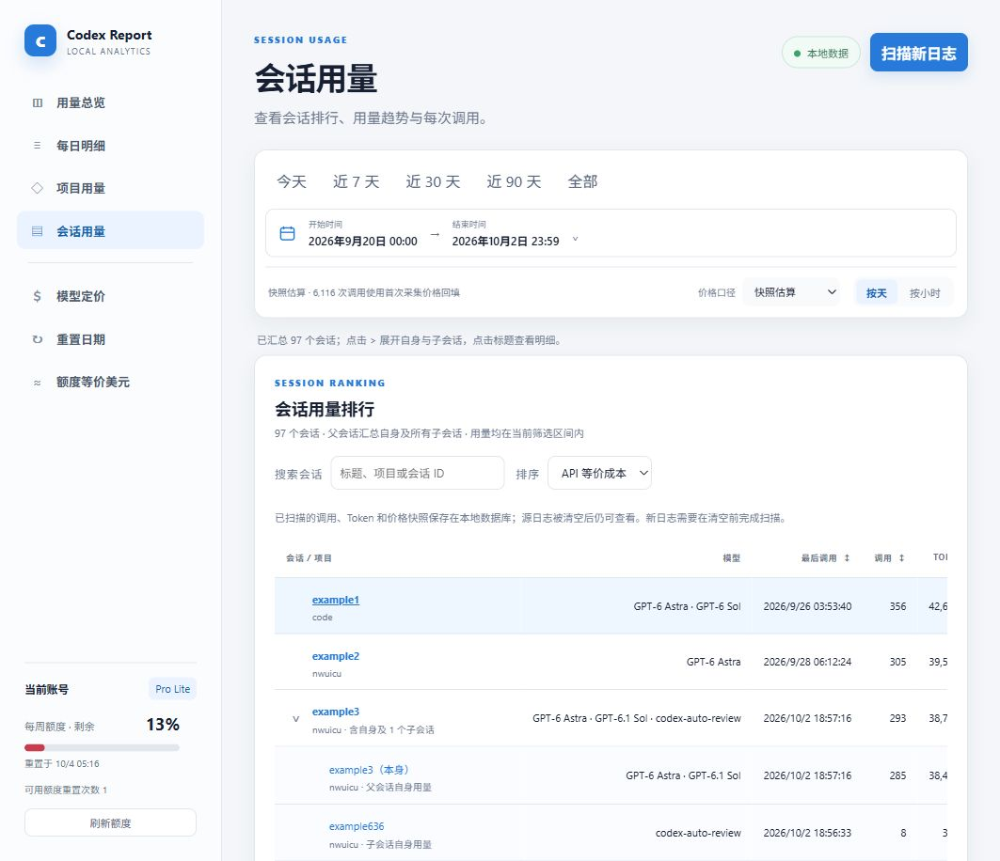
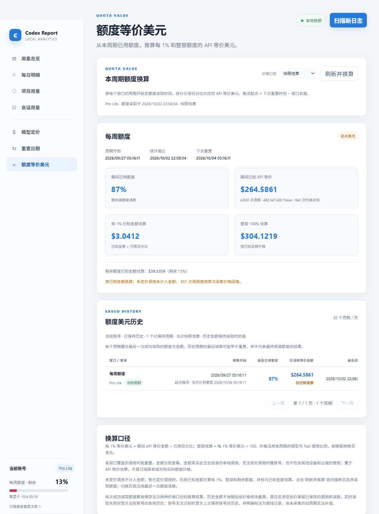

# Codex Token Report

Windows 版本的 CodexBar 总是统计不了当日用量, 于是纯 Vibe Coding 做了一个 Web 版本.

部分计算参考 [CodexBar](https://github.com/steipete/CodexBar).

只读扫描本机 Codex 日志, 在浏览器查看 Token 用量、成本估算、项目与会话统计、账号额度和重置历史.
统计保存在本地, 源日志清理后仍可查看已采集的记录.

## 安装与启动

需要 Python 3.12+ 和 [uv](https://docs.astral.sh/uv/). 下载或克隆仓库后, 在仓库根目录运行:

```sh
uv sync --locked
uv run codex-token-report --port 8765 --tray
```

**所有参数均可选**; 不加参数时以普通网页模式启动并自动打开浏览器.

| 参数 | 默认值 | 作用 |
| --- | --- | --- |
| `--host 地址` | `127.0.0.1` | 网页服务监听地址. |
| `--port 端口` | `8765` | 网页服务端口. |
| `--tray` | 不启用 | 启用系统托盘 / 菜单栏图标. |
| `--no-browser` | 不启用 | 启动时不自动打开网页, 仍可手动打开. |
| `--codex-home 路径` | 已保存的目录; 首次使用为用户主目录下的 `.codex` | 指定 Codex 日志目录. |
| `--data-dir 路径` | Windows: `$env:LOCALAPPDATA\CodexTokenReport`; macOS / Linux: `~/.local/share/codex-token-report` | 指定统计数据库等应用数据的保存目录. |
| `--timezone 时区` | `Asia/Taipei` | 统计使用的 IANA 时区, 如 `Asia/Shanghai`. |
| `--scan-interval-minutes 分钟` | `60` | 后台日志扫描间隔; `0` 关闭定时扫描. |
| `--scan-only` | 不启用 | 只扫描一次后退出, 不启动网页或托盘; 优先于 `--tray`. |
| `-h` / `--help` | 不启用 | 显示帮助后退出. |

## 更新

更新代码后运行 `uv sync --locked`, 再重启程序. 修改前端源码后需重新构建,
命令见[前端构建与更新](docs/details.md#前端构建与更新).

## 应用截图

用量总览:



会话用量:



额度等价美元与保存的周期历史:



## 更多说明

- [使用与统计说明](docs/details.md): 价格与档位规则、额度采样、数据目录、更多启动方式及开发命令.
- [前端开发说明](frontend/README.md)

许可证: [GPL-3.0-only](LICENSE).
